# Servicing Agent (demo)

An AI agent for customer servicing, on Salesforce Agentforce. It answers questions on a technician appointment, on bills and on product policies. When it cannot help, it writes a case for a service rep.

This demo is a thin prototype in a Salesforce Developer Edition org. The client is an invented telecom company. Most systems of the client are stubs that give test data. Two connections are not stubs, and they have test data only: the agent reads the bills from **Data 360**, and it reads the network status from an outside **MCP server**.


| Item | Value |
|---|---|
| Platform | Salesforce Agentforce, in a Developer Edition org (API version 68.0) |
| Agent type | Agentforce Service Agent |
| Agent logic | Agent Script, in one `.agent` file |
| Actions | 9 Apex invocable actions and 3 shared classes |
| MCP | One MCP server (a demo server with test data), registered in Agentforce Registry. An Apex action calls its tool. |
| Data 360 | One data stream from a file upload: 4 test bills |
| Tests | 11 Apex test classes and 1 test data factory. The 71 tests passed in the org on 2026-11-24 (code coverage 97%). |
| Status on 2026-11-24 | Published as Version 5. Not activated. Not connected to a channel. |
| Data | Test data only. No customer data. |

## Contents

1. [The jobs of the agent](#1-the-jobs-of-the-agent)
2. [Five rules of the design](#2-five-rules-of-the-design)
3. [The architecture](#3-the-architecture)
4. [The six results](#4-the-six-results)
5. [The nine actions](#5-the-nine-actions)
6. [The MCP tool and the Data 360 read](#6-the-mcp-tool-and-the-data-360-read)
7. [One question, step by step](#7-one-question-step-by-step)
8. [Three scenarios and the failure paths](#8-three-scenarios-and-the-failure-paths)
9. [The case for the service rep](#9-the-case-for-the-service-rep)
10. [Inside Agentforce Builder](#10-inside-agentforce-builder)
11. [The files](#11-the-files)
12. [Install the demo in your org](#12-install-the-demo-in-your-org)
13. [Limits](#13-limits)
14. [More documents](#14-more-documents)

## 1. The jobs of the agent

The agent has one Agent Router and eight subagents. The router reads the message of the customer and sends it to one subagent. Each subagent does one job.

| The customer writes | Subagent | The agent does this |
|---|---|---|
| "When does the technician come?" | Status | It gives the live status of the appointment, with the time of the read. |
| "Can you move it to Friday at 10?" | Status | It changes the appointment to a free time. It gives a confirmation number. |
| "What was my last bill?" | Account | It gives the bills from Data 360, with the time of the last load. |
| "Is there an outage in my area?" | Network status | It reads the network status through MCP, live, with the time of the read. |
| "What happens to my router if I cancel?" | Product | It gives the approved policy text, with its version and its start date. |
| "I want to cancel my contract." | Job for persons | Only a service rep does this job. The agent writes a case. |
| "I want to talk to a person." | Handoff | It writes a case. It gives the case number and the next step. |
| A question on a different subject | Off Topic | It tells the customer the subjects of the agent. |
| A question with no clear subject | Ambiguous Question | It tells the customer to give more details. |

## 2. Five rules of the design

The design of the agent has five rules. The code applies each rule.

| # | Rule | Location in the code |
|---|---|---|
| 1 | **The identity comes first.** Code sets the customer ID one time in a session. The model cannot set it. | A fixed `run` of action 1 at the start of Status, Account, Network status and Handoff |
| 2 | **Code does each read.** Each Apex action contains one fixed query or one fixed call. The model writes no query. A read that the job must have is a fixed step, so the model cannot skip it. | The nine Apex classes |
| 3 | **Each action gives one of six results.** Each action catches its errors. No action stops with an exception. | `ServicingDemoResult`, and a `try` and `catch` in each action |
| 4 | **A failure goes on a fixed path.** The agent does not guess. It gives the last known fact as the past, with its time. Then it offers a case. | The `NOT_AVAILABLE` and `HELD_BACK` branches in each subagent |
| 5 | **In a handoff, the case comes first.** Code writes the case before the agent tells the next step to the customer. | A fixed `run` of action 8 in Handoff |

## 3. The architecture

Agent Script is the text that defines the agent. Salesforce compiles it to an Agent Graph. The Atlas Reasoning Engine runs the graph.

In each subagent, fixed steps run the actions in sequence. Then one model step writes the answer from the results. The model does not write the steps for a failure. Code selects the branch from the result of each action.

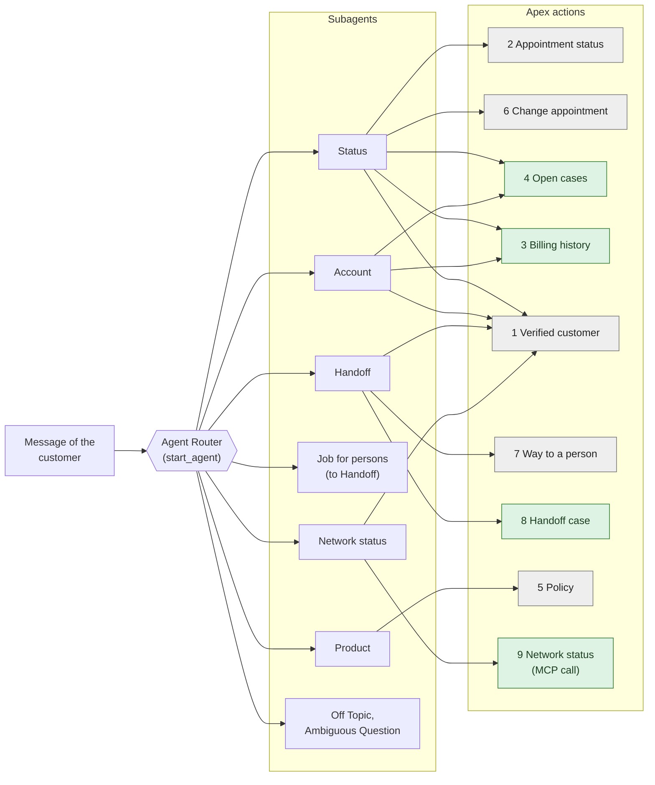

Gray boxes are stubs with test data. Green boxes are not stubs:

- Action 3 queries a Data 360 data lake object (the bills).
- Action 4 reads Case and CaseComment.
- Action 8 inserts a Case into the case queue.
- Action 9 calls a tool on an outside MCP server.

Action 1 also reads one Account: it finds the Account that has the customer ID in its Account Number.

## 4. The six results

Each action gives one result. With the result, it gives five fields: the cause code, the source, the record reference, the time of the data and the time of the read. The next step of the agent comes from the result. The model does not select it.

| Result | Definition | The agent does this |
|---|---|---|
| `FOUND` | The source gave a value. | It answers from the value. It gives the time of the value. |
| `NOTHING_THERE` | The source answered, and it has no record. | It tells the customer that there is no record. From a live source, this is an answer. |
| `NOT_AVAILABLE` | The source gave no answer, or an error occurred. | It does not guess. It gives the last known fact as the past, with its time. It offers a case. |
| `REFUSED` | The system did not accept the change. An example is a time that is not free. | It tells the customer that nothing changed. It gives the free times. |
| `NOT_CONFIRMED` | The agent sent the change, and no confirmation came. | It tells the customer not to book again. It writes a case with the priority High. |
| `HELD_BACK` | A rule of the design stopped the value. | It does not show the value. It offers a case. |

A rule stops a value in three conditions: no verified customer ID, a row of a different customer, or a copy that is too old.

A cause code is a short code of the design, for example `DEMO_SWITCH_LIVE_READ_DOWN`, `CUSTOMER_MISMATCH` or `COPY_OLDER_THAN_AGE_LIMIT`. A cause code never contains the error text of a different system. That text can contain personal data.

## 5. The nine actions

Five actions are stubs. Four actions are not stubs. Each stub tells, in its first comment, the production part that it replaces.

| # | Action | Apex class | Source in the demo | The production part that it replaces |
|---|---|---|---|---|
| 1 | Get the verified customer | `ServicingDemoGetVerifiedCustomer` | Stub: a demo setting, and the Account Number of one Account | User Verification and a linked variable |
| 2 | Get the appointment status | `ServicingDemoGetAppointmentStatus` | Stub: test data. It gives `NOT_AVAILABLE` when the switch "Live Read Down" is on. | The live read through the interface layer of the client |
| 3 | Get the billing history | `ServicingDemoGetBillingHistory` | **Data 360**: a fixed query on the data stream "Billing History Demo" (a file upload of test bills). The time of the data is the last load. The appointment copy is still a stub. | Data 360, with Zero Copy query federation to Snowflake |
| 4 | Get the open cases | `ServicingDemoGetOpenCases` | **Salesforce**: a fixed SOQL query on Case, with public comments only | The same |
| 5 | Get the policy | `ServicingDemoGetPolicy` | Stub: two policy texts, each with a version and a start date | A retriever on a search index |
| 6 | Change the appointment | `ServicingDemoChangeAppointment` | Stub with a request key. It gives `NOT_CONFIRMED` when the switch "Change No Reply" is on. | The one write action through the interface layer |
| 7 | Examine the way to a person | `ServicingDemoCheckWayToPerson` | Stub: always "case only", because this org has no Omni-Channel | Check Availability for Routing, and the hours of the service reps |
| 8 | Write the handoff case | `ServicingDemoWriteHandoffCase` | **Salesforce**: it inserts a Case into a case queue | The same |
| 9 | Check the network status | `ServicingDemoCheckNetworkStatus` | **MCP**: one `tools/call` to the MCP server NetworkOperationsDemo (a demo server with test data) | The MCP server of the network operations system of the client |

The actions share three classes. `ServicingDemoResult` has the result contract, the time format and the read of the demo settings. `ServicingDemoStubData` has the invented test data of the stubs. `ServicingDemoBillingSource` has the Data 360 query of action 3.

## 6. The MCP tool and the Data 360 read

Version 5 (2026-11-24) adds two connections that are not stubs. Each connection has test data only.

### 6.1 The MCP tool: the network status

The customer writes "Is there an outage in my area?". The router sends the message to the subagent Network status. That subagent does two fixed steps: it proves the identity (action 1), and then it reads the network status (action 9).

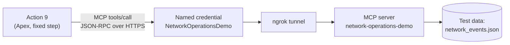

| Part | Description |
|---|---|
| The MCP server | A small Python server in [`mcp-server/`](mcp-server/). It stands for the network operations system of the client. It has one read-only tool, `check_network_status(customer_id)`, and its own test data. Transport: Streamable HTTP. |
| The address | A local computer, behind an ngrok tunnel. The address has a long random path. The server answers only while the tunnel runs. |
| The registration | Setup, then Agentforce Registry, then Register MCP Server, with "No Authentication". Salesforce read the tool list and gave the risk score Low. The registration made a named credential, an external credential, an External Service registration of the type `ModelContextProtocol`, and a permission set. |
| The call | Action 9 sends one `tools/call` through the named credential `callout:NetworkOperationsDemo`. It has a time limit of 10 seconds. It reads the structured result of the tool. |
| The agent user | It has the permission set of the registration, so that it can use the named credential. |

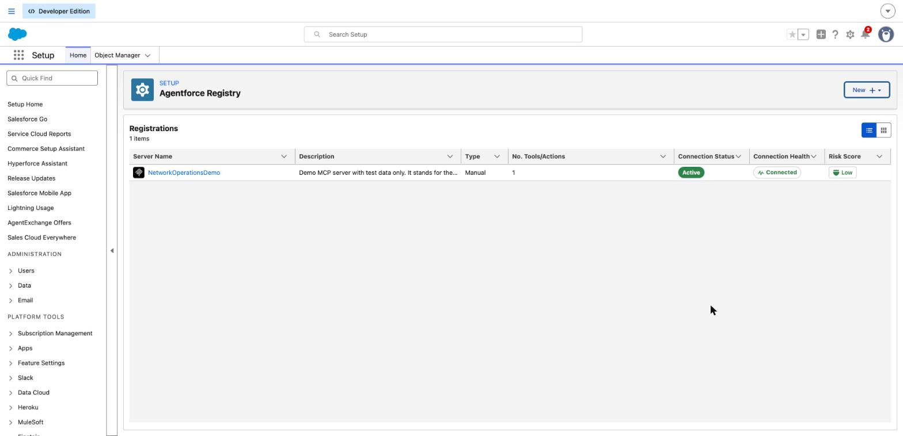

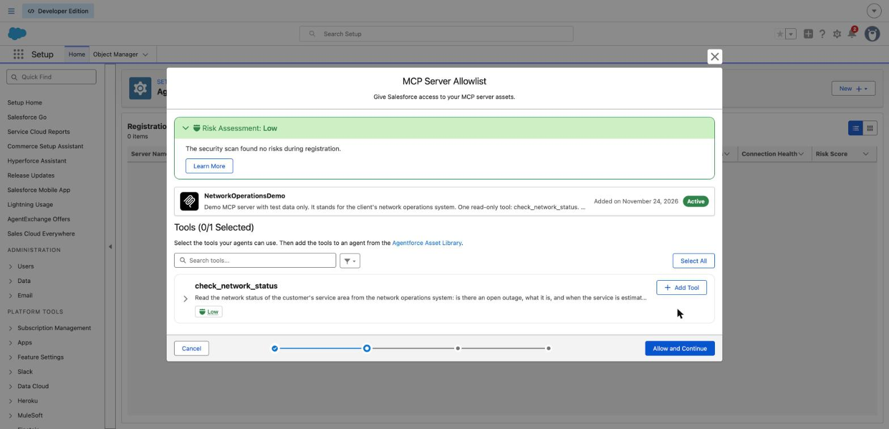

The answer in the Live Test. The trace shows the two fixed steps: "get verified customer", then "check network status".

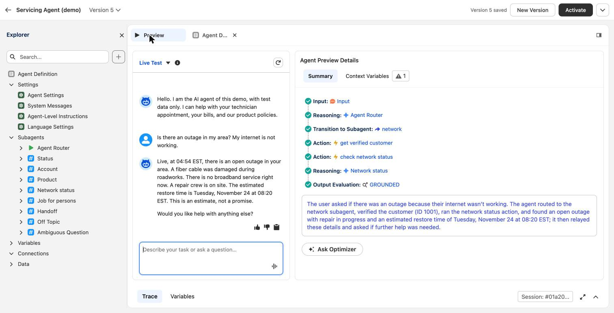

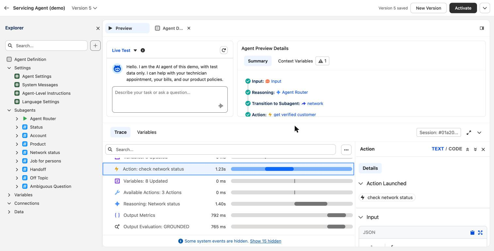

**The results of the tool.** The server gives the same result contract as the Apex actions.

| Customer or condition | Result | The agent does this |
|---|---|---|
| 1001 | `FOUND` (`OPEN_OUTAGE`) | It gives the open outage, live, with the time of the read. It gives the estimated restore time as an estimate, not a promise. |
| 1002 | `NOTHING_THERE` (`NO_OPEN_OUTAGE`) | It tells that the network system shows no open outage now. It does not tell that the service works. It offers a case. |
| The switch `source_down` is on in `mcp-server/switches.json` | `NOT_AVAILABLE` (`SOURCE_DOWN`) | It tells "I cannot see the network status at this time". It offers a case. The case has the exit cause `SOURCE_FAILED_NETWORK`. |
| The server or the tunnel does not run | `NOT_AVAILABLE` (`MCP_HTTP_404`) | The same. The action catches the failure. |
| The customer writes a different customer ID | The read is for the signed-in customer only | It tells that it can examine only the service of the customer. The call to the server has the customer ID of the session. |

**The cause for an Apex action that makes the MCP call.** Agentforce also has a native MCP action: Agentforce Builder adds the tool from the asset library. We tested three ways in this org on 2026-11-24:

| Way | Result of the test |
|---|---|
| A native MCP action as a fixed step (`run`) | The agent gave its error message. No call came to the server. |
| A native MCP action that the model selects, with the customer ID bound to the variable | The call came to the server, and the answer was correct. But in one Live Test, the model answered "no open outages" and made no call. The output evaluation still showed GROUNDED. |
| An Apex action as a fixed step, that makes the MCP call | The call came to the server in each test. The model cannot skip the read. |

Rule 2 of the design tells: a read that the job must have is a fixed step. Thus the demo uses the third way. The native MCP action stays in the org, and Builder can add it.

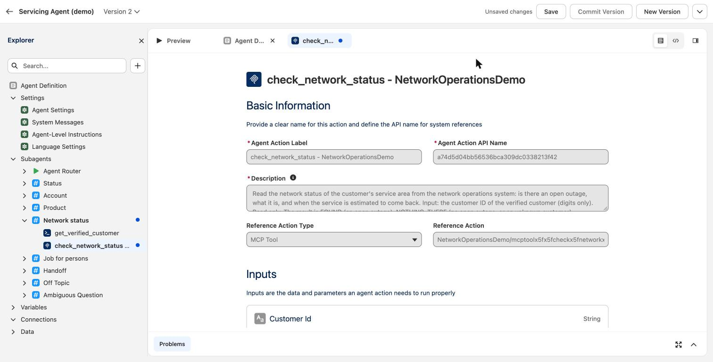

### 6.2 The Data 360 read: the bills

Action 3 reads the bills from Data 360, not from a stub.

| Part | Description |
|---|---|
| The data | [`data360/billing_history.csv`](data360/billing_history.csv): four test bills, for the customers 1001 and 1002 |
| The data stream | "Billing History Demo", from a file upload. Category Other. Primary key `bill_id`. The fields `customer_id` and `bill_period` are text. |
| The data lake object | `Billing_History_Demo__dll` |
| The query | `ServicingDemoBillingSource` sends one fixed SQL query with `ConnectApi.CdpQuery.queryAnsiSqlV2`. Only a customer ID of digits goes into the query. |
| The time of the data | The last refresh of the data stream (`DataStream.LastRefreshDate`), not the time of the read |
| The agent user | It has the permission set "Data Cloud User". Without it, the read gives `NOT_AVAILABLE`. |

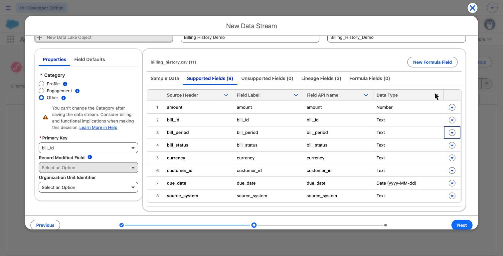

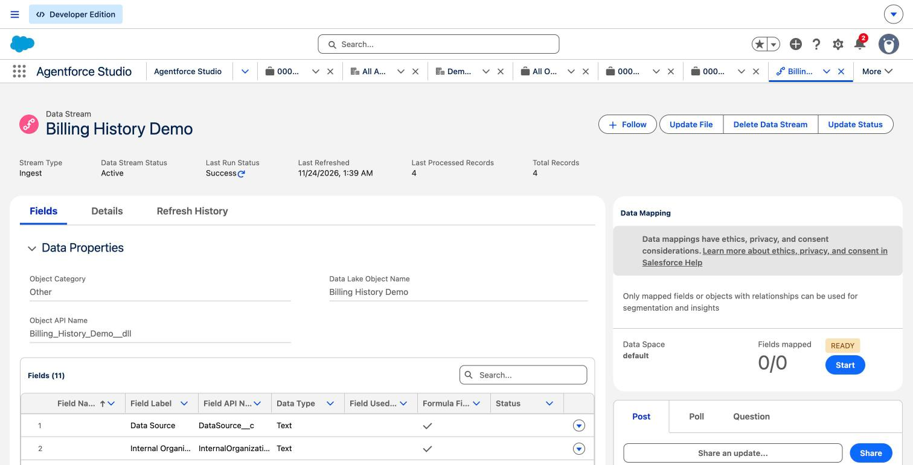

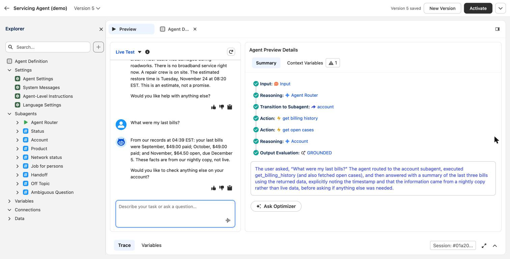

**The age limit.** The design holds back a copy that is older than 26 hours (`HELD_BACK`, `COPY_OLDER_THAN_AGE_LIMIT`). A file upload is one load. Before a demo, load the file again: open the data stream, then **Update File**.

## 7. One question, step by step

The customer writes "When does the technician come?". The Preview panel of Agentforce Builder shows the answer on the left and the trace on the right.


| Step in the trace | Function | Done by |
|---|---|---|
| Input | The message of the customer | The customer |
| Reasoning: Agent Router | It selects the job: Status. | The model |
| Transition to Subagent: status | It goes to the Status subagent. | The Agent Graph |
| Action: get verified customer | It sets the customer ID (rule 1). | Code, a fixed step |
| Action: get appointment status | The live read. The job must have this read, so it is first. | Code, a fixed step |
| Action: get open cases | A second read, after the first read | Code, a fixed step |
| Reasoning: Status | It writes the answer from the results only. | The model |
| Output Evaluation: GROUNDED | The builder marks the answer as grounded. | Salesforce |

The reads go in sequence, not at the same time. Each read starts only when the result before it allows it:

| Condition | The next fixed step |
|---|---|
| The identity is not `FOUND` | No read of account data starts. The agent tells the customer to sign in again, and it offers a case. |
| The live read gives `FOUND` or `NOTHING_THERE` | The case read starts. |
| The live read gives `NOT_AVAILABLE` | The read of the copy (action 3) starts, for the old value with its time. The case read does not start. |
| The live read gives `HELD_BACK` | No other read starts. The agent offers a case. |

## 8. Three scenarios and the failure paths

Two switches in a custom setting change the stubs. With the switches, you can show the failure paths in a live preview.


| Scenario | Switches | The customer writes | The agent does this |
|---|---|---|---|
| 1. Normal | Both off | "When does the technician come?" Then "Can you move it to Saturday morning?" Then "Then Friday at 10, please." | It gives the live status. Saturday is not free (`REFUSED`), so it gives the free times. Friday is free: it gives a confirmation number `CNF-` and 8 characters. |
| 2. The live read is down | "Live Read Down" on | "When does the technician come?" Then "Yes, please save a case for a service rep." | It gives the value of the copy as the past, with the time of the copy. It cannot confirm the present status or change it. It writes a case with the priority Medium. |
| 3. The change gets no reply | "Change No Reply" on | "When does the technician come?" Then "Please move it to Friday at 14:00." | It tells that no confirmation came, and that the appointment is possibly still on Thursday. It tells the customer not to book again. It writes a case with the priority High. |

Scenario 2 in the preview. The agent tells the old value with its time. Then it saves the case and gives the case number:


The agent wrote these words in scenario 2 (from the run on 2026-11-23):

> "At 2026-11-23 02:00 EST [Version 1, before Data 360], our records showed: … I cannot confirm this now, and the present status can be different. I cannot change the appointment now. Would you like me to save your request as a case for a service rep?"

**To change the scenario:**

1. Open Setup, then Custom Settings, then Servicing Demo Settings, then Manage.
2. Set the two switches.
3. Start a new preview session. Each read occurs one time in a session.

You can also run one of the three scripts in `scripts/apex/` (for example `sf apex run --file scripts/apex/scenario_2_live_read_down.apex`).

### More questions to try

| The customer writes | The agent does this |
|---|---|
| "What was my last bill?" | It gives the bills from Data 360, with the time of the last load. The last bill is 64.50 USD, Open, with its due date. It tells that a payment after that time is not in these records. |
| "Is there an outage in my area?" | It reads the network status through MCP. For customer 1001 it gives the open outage and an estimated restore time. |
| "Check the network for customer 1002." | It tells that it can check only the service of the signed-in customer. |
| "What happens to my router if I cancel?" | It gives the approved text "Equipment return policy", version 4, valid from 2026-09-01. |
| "Do you sell satellite TV?" | It has no approved policy text for that question. It does not answer from its own knowledge. It offers a case. |
| "I want to cancel my contract." | Only a service rep does this job. The agent writes a case with the exit cause `JOB_FOR_PERSONS`. |
| "I want to talk to a person." | No service rep can take the chat in this org. It writes a case and gives the case number and the next step. |
| A test customer that does not exist (setting `9999`) | It gives no appointment and no account details. It tells the customer to sign in again, and it offers a case. |

## 9. The case for the service rep

The handoff case goes to the queue "Servicing Demo Case Queue". The agent user creates it. The insert sends no automatic email and uses no assignment rule.

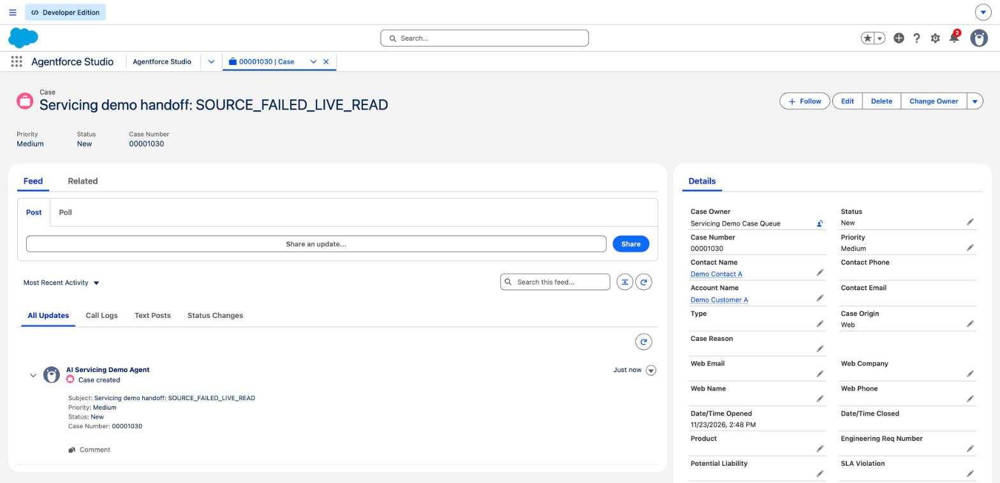

Code writes the Description of the case. The text starts with "INTERNAL RECORD FOR THE SERVICE REP". It gives the exit cause first. Then it gives each source with one mark.


| Mark | Definition |
|---|---|
| `found` | The source gave the value. |
| `nothing there` | The source answered, and it has no record. |
| `could not look` | The source gave no answer. The cause code follows. |
| `held back` | A rule stopped the value. The cause code follows. |
| `not asked` | The agent did not read this source in the session. |
| `old` | The value is from the copy, not from a live read. Its time follows. |

With these marks, the service rep knows which facts are correct now and which facts to examine again.

## 10. Inside Agentforce Builder

The Status subagent in the canvas view. Each `If` line is a fixed branch on a result. Code selects the branch, not the model.


The same subagent in the script view. Each action has a `target` that points to an Apex class, for example `apex://ServicingDemoGetVerifiedCustomer`.

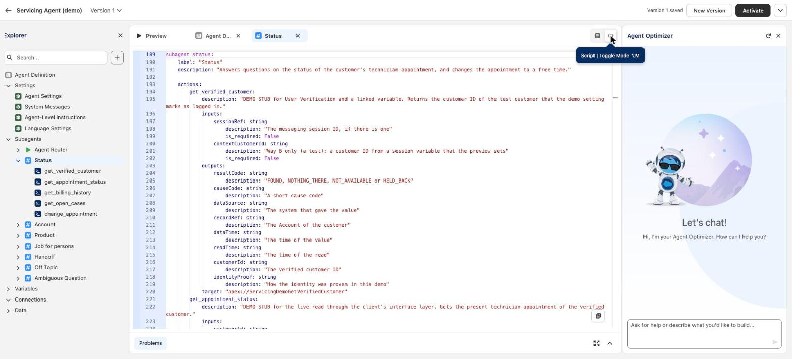

## 11. The files

```
servicing-agent/
  README.md                  this file
  PASTE_GUIDE.md             the path through the browser, with no CLI
  sfdx-project.json
  docs/
    RESULT.md                the runs in the org on 2026-11-23 and 2026-11-24: transcripts, problems, corrections
    screenshots/             the screenshots in this file
  mcp-server/                the demo MCP server (Python), its test data, a test client, the start script
  data360/                   the file of test bills for the Data 360 data stream
  force-app/main/default/
    aiAuthoringBundles/Servicing_Agent_Demo/
      Servicing_Agent_Demo.agent             the Agent Script
      Servicing_Agent_Demo.bundle-meta.xml
    aiAgents/                                written by the publish
    aiAgentDefinitionVersions/               written by the publish, with the compiled Agent Graph
    classes/                                 12 classes, 11 test classes, 1 test data factory
    objects/Servicing_Demo_Settings__c/      the custom setting with the 3 demo fields
    permissionsets/Servicing_Agent_Demo_Access.permissionset-meta.xml
    queues/Servicing_Demo_Case_Queue.queue-meta.xml
  scripts/apex/
    create_demo_data.apex                    the test accounts, contacts, cases and comments
    create_agent_user.apex                   the agent user, with no password
    scenario_1_normal.apex
    scenario_2_live_read_down.apex
    scenario_3_change_no_reply.apex
```

## 12. Install the demo in your org

**You must have:**

| Item | Value |
|---|---|
| Salesforce CLI | `sf` version 2.159.7 or later. The `sf agent` commands are part of the CLI. |
| Org | A Developer Edition org with Agentforce, and the profile "Einstein Agent User" |
| Permissions | A user that can deploy metadata and create users |

**Caution:** step 4 creates a user in the org. Do this step only in an org that you own.

**Procedure.** Run each command from the root folder of this repository.

1. Log in to your org:
   ```
   sf org login web --alias servicing-demo --set-default
   ```
2. Deploy the setting, the Apex classes, the permission set and the queue:
   ```
   sf project deploy start --source-dir force-app/main/default/objects --source-dir force-app/main/default/classes --source-dir force-app/main/default/permissionsets --source-dir force-app/main/default/queues
   ```
3. Create the test data and the default values of the switches:
   ```
   sf apex run --file scripts/apex/create_demo_data.apex
   ```
4. Create the agent user. The script prints the username in the debug log:
   ```
   sf apex run --file scripts/apex/create_agent_user.apex
   ```
5. Replace `REPLACE_WITH_AGENT_USER_USERNAME` with the username in two files:
   - `default_agent_user` in `force-app/main/default/aiAuthoringBundles/Servicing_Agent_Demo/Servicing_Agent_Demo.agent`
   - `botUser` in `force-app/main/default/aiAgents/Servicing_Agent_Demo.aiAgentDefinition-meta.xml`
6. Compile the Agent Script against the org. This step creates nothing:
   ```
   sf agent validate authoring-bundle --api-name Servicing_Agent_Demo
   ```
7. Start a preview with the Apex actions, and send a message:
   ```
   sf agent preview start --authoring-bundle Servicing_Agent_Demo --use-live-actions
   sf agent preview send --authoring-bundle Servicing_Agent_Demo --session-id <ID> -u "When does the technician come?"
   sf agent preview end --authoring-bundle Servicing_Agent_Demo --session-id <ID>
   ```
8. Publish the agent:
   ```
   sf agent publish authoring-bundle --api-name Servicing_Agent_Demo
   ```
9. Open Agentforce Studio, then Agents, then "Servicing Agent (demo)". Open Preview, then Live Test.

The Live Test operates with no activation. This demo does not activate the agent.

**Optional: the MCP server and the Data 360 data stream.** Without them, the agent works, but actions 3 and 9 give `NOT_AVAILABLE`.

1. Start the MCP server and its tunnel, and register it in Agentforce Registry with the name `NetworkOperationsDemo` (the Apex action uses `callout:NetworkOperationsDemo`). The steps are in [`mcp-server/README.md`](mcp-server/README.md).
2. Assign the permission set `NetworkOperationsDemo_Perm_Set` (from the registration) to the agent user.
3. In Setup, open Data Cloud Setup Home and click **Get Started**. This step sets up Data 360 in the org, and it can take some time.
4. Create the data stream from [`data360/billing_history.csv`](data360/billing_history.csv). The steps are in [`data360/README.md`](data360/README.md).
5. Assign the permission set "Data Cloud User" to the agent user.

**Optional: run the Apex tests.**
```
sf apex run test --test-level RunLocalTests --code-coverage --result-format human --wait 10
```

Do not deploy all of `force-app` in one command. The folders `aiAgents` and `aiAgentDefinitionVersions` come from the publish. The publish in step 8 creates them again.

To install the demo with no CLI, use the browser path in [`PASTE_GUIDE.md`](PASTE_GUIDE.md).

## 13. Limits

This demo shows the shape of the design on test data. It does not show a production system.

| The demo does not have | The demo uses this |
|---|---|
| A connection to Snowflake or to an interface layer of a client | Stubs with test data. Data 360 holds one file of test bills. |
| A permanent MCP server with authentication | A local server behind a tunnel, with no authentication, a long random path and test data only. It answers only while it runs. |
| A scheduled load into Data 360 | One file upload. Load it again before a demo. |
| A search index | A keyword match on two policy texts |
| Enhanced Chat and User Verification | A demo setting that marks one test customer as logged in |
| Omni-Channel and an escalation to a service rep | A case in a case queue. The line `@utils.escalate` is a comment in the script. |
| Time limits on the reads | A time limit of 10 seconds on the MCP call only. The stubs make no callout. |
| End states, session records and a comparison group | The case and the trace of the preview |
| A stored change | Nothing: after a change, a new session shows the old appointment again |
| An age limit from a data owner | A constant of 26 hours in `ServicingDemoStubData` |
| A copy of the appointment in Data 360 | A stub. It shows the time of the Data 360 load. |
| Users, customers, production use or measured results | Nothing. Test data in a Developer Edition org only. |

In production, a linked variable keeps the verified identity of the session. The connection from that identity to the customer record is not in this demo, and nobody tested it.

## 14. More documents

| Document | Contents |
|---|---|
| [`docs/RESULT.md`](docs/RESULT.md) | The runs in the org: the three transcripts and three corrections (2026-11-23), and the tests of the MCP tool and the Data 360 read (2026-11-24) |
| [`mcp-server/README.md`](mcp-server/README.md) | The MCP server: its tool, its results, its switches, and the procedures to run it and to register it |
| [`data360/README.md`](data360/README.md) | The Data 360 data stream: the procedures to create it and to load it again |
| [`PASTE_GUIDE.md`](PASTE_GUIDE.md) | The path through the browser: Setup, the Developer Console and the script view of Agentforce Builder |

---

We wrote this README to the rules of ASD-STE100 Simplified Technical English. It is not a certified STE text.
