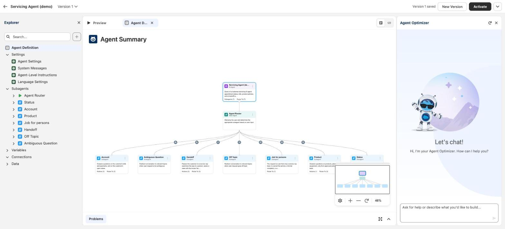
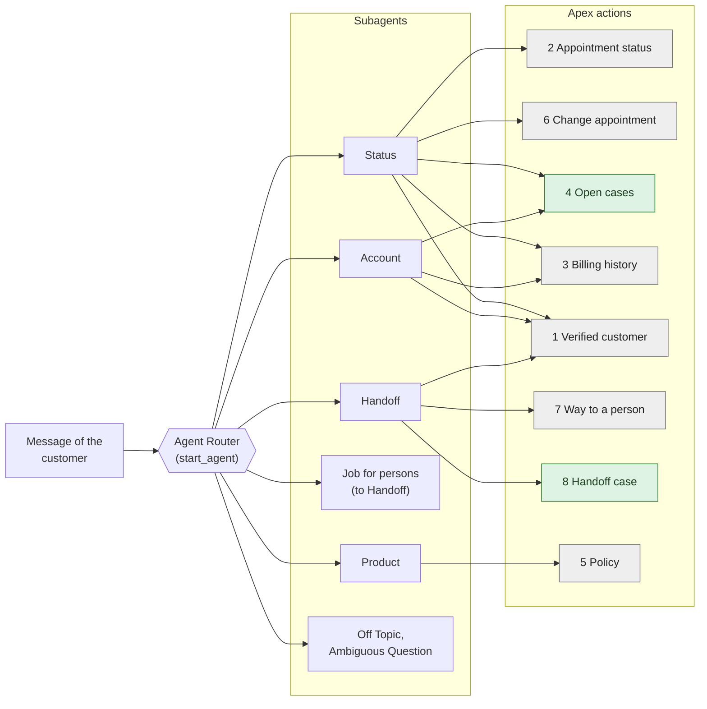
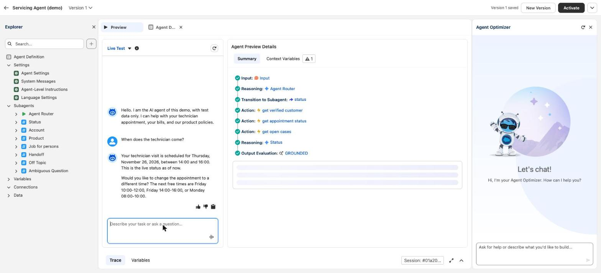
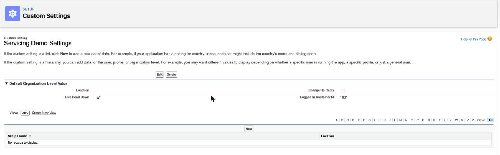
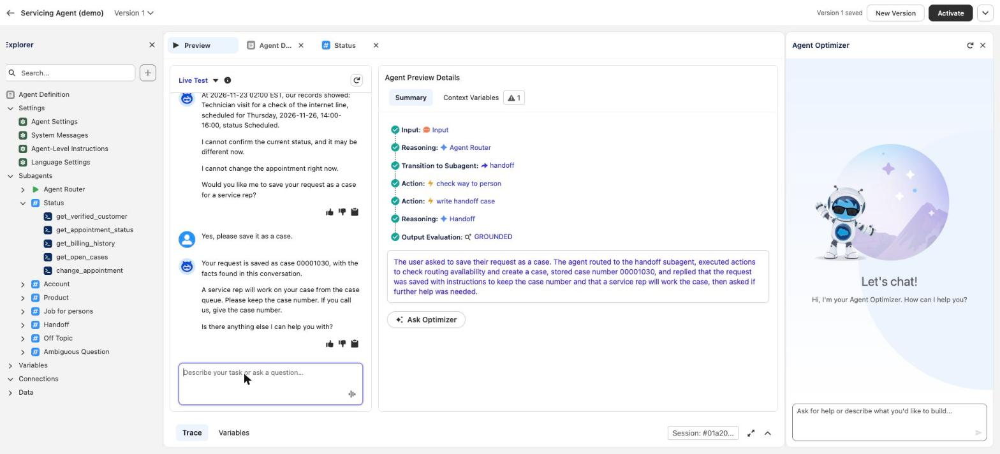
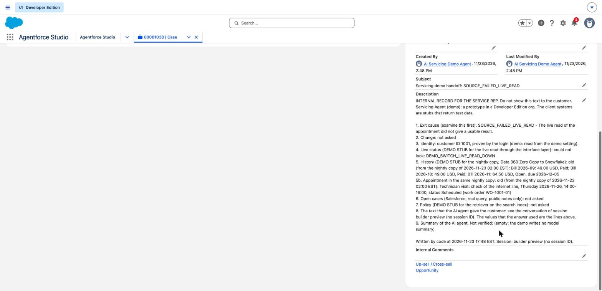
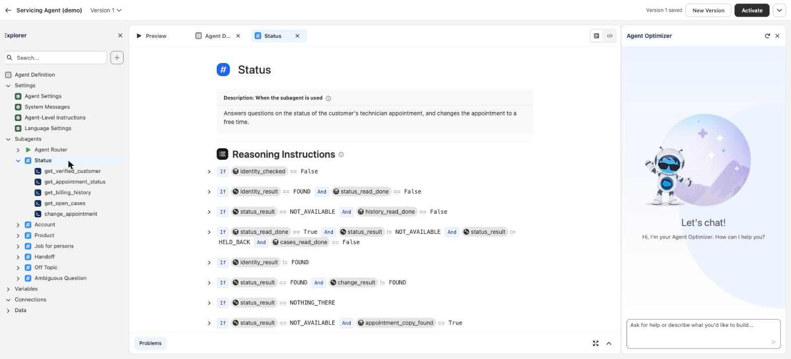

# Servicing Agent (demo)

An AI agent for customer servicing, on Salesforce Agentforce. It answers questions on a technician appointment, on bills and on product policies. When it cannot help, it writes a case for a service rep.

This demo is a thin prototype in a Salesforce Developer Edition org. The systems of the client are stubs that give test data. The client is an invented telecom company.



| Item | Value |
|---|---|
| Platform | Salesforce Agentforce, in a Developer Edition org (API version 68.0) |
| Agent type | Agentforce Service Agent |
| Agent logic | Agent Script, in one `.agent` file |
| Actions | 8 Apex invocable actions and 2 shared classes |
| Tests | 9 Apex test classes and 1 test data factory. The 53 tests passed in the org on 2026-11-23. |
| Status on 2026-11-23 | Published as Version 1. Not activated. Not connected to a channel. |
| Data | Test data only. No customer data. |

## Contents

1. [The jobs of the agent](#1-the-jobs-of-the-agent)
2. [Five rules of the design](#2-five-rules-of-the-design)
3. [The architecture](#3-the-architecture)
4. [The six results](#4-the-six-results)
5. [The eight actions](#5-the-eight-actions)
6. [One question, step by step](#6-one-question-step-by-step)
7. [Three scenarios and the failure paths](#7-three-scenarios-and-the-failure-paths)
8. [The case for the service rep](#8-the-case-for-the-service-rep)
9. [Inside Agentforce Builder](#9-inside-agentforce-builder)
10. [The files](#10-the-files)
11. [Install the demo in your org](#11-install-the-demo-in-your-org)
12. [Limits](#12-limits)
13. [More documents](#13-more-documents)

## 1. The jobs of the agent

The agent has one Agent Router and seven subagents. The router reads the message of the customer and sends it to one subagent. Each subagent does one job.

| The customer writes | Subagent | The agent does this |
|---|---|---|
| "When does the technician come?" | Status | It gives the live status of the appointment, with the time of the read. |
| "Can you move it to Friday at 10?" | Status | It changes the appointment to a free time. It gives a confirmation number. |
| "What was my last bill?" | Account | It gives the bills from the nightly copy, with the time of that copy. |
| "What happens to my router if I cancel?" | Product | It gives the approved policy text, with its version and its start date. |
| "I want to cancel my contract." | Job for persons | Only a service rep does this job. The agent writes a case. |
| "I want to talk to a person." | Handoff | It writes a case. It gives the case number and the next step. |
| A question on a different subject | Off Topic | It tells the customer the subjects of the agent. |
| A question with no clear subject | Ambiguous Question | It tells the customer to give more details. |

## 2. Five rules of the design

The design of the agent has five rules. The code applies each rule.

| # | Rule | Location in the code |
|---|---|---|
| 1 | **The identity comes first.** Code sets the customer ID one time in a session. The model cannot set it. | A fixed `run` of action 1 at the start of Status, Account and Handoff |
| 2 | **Code does each read.** Each Apex action contains one fixed query. The model selects an action, but it writes no query. | The eight Apex classes |
| 3 | **Each action gives one of six results.** Each action catches its errors. No action stops with an exception. | `ServicingDemoResult`, and a `try` and `catch` in each action |
| 4 | **A failure goes on a fixed path.** The agent does not guess. It gives the last known fact as the past, with its time. Then it offers a case. | The `NOT_AVAILABLE` and `HELD_BACK` branches in each subagent |
| 5 | **In a handoff, the case comes first.** Code writes the case before the agent tells the next step to the customer. | A fixed `run` of action 8 in Handoff |

## 3. The architecture

Agent Script is the text that defines the agent. Salesforce compiles it to an Agent Graph. The Atlas Reasoning Engine runs the graph.

In each subagent, fixed steps run the actions in sequence. Then one model step writes the answer from the results. The model does not write the steps for a failure. Code selects the branch from the result of each action.



Gray boxes are stubs with test data. Green boxes use records in Salesforce: action 4 reads Case and CaseComment, and action 8 inserts a Case into the case queue. Action 1 also reads one Account: it finds the Account that has the customer ID in its Account Number.

## 4. The six results

Each action gives one result. With the result, it gives five fields: the cause code, the source, the record reference, the time of the data and the time of the read. The next step of the agent comes from the result. The model does not select it.

| Result | Definition | The agent does this |
|---|---|---|
| `FOUND` | The source gave a value. | It answers from the value. It gives the time of the value. |
| `NOTHING_THERE` | The source answered, and it has no record. | It tells the customer that there is no record. From a live source, this is an answer. |
| `NOT_AVAILABLE` | The source gave no answer, or an error occurred. | It does not guess. It gives the last known fact as the past, with its time. It offers a case. |
| `REFUSED` | The system did not accept the change. An example is a time that is not free. | It tells the customer that nothing changed. It gives the free times. |
| `NOT_CONFIRMED` | The agent sent the change, and no confirmation came. | It tells the customer not to book again. It writes a case with the priority High. |
| `HELD_BACK` | A rule of the design stopped the value. | It does not show the value. It offers a case. |

A rule stops a value in three conditions: no verified customer ID, a row of a different customer, or a copy that is too old.

A cause code is a short code of the design, for example `DEMO_SWITCH_LIVE_READ_DOWN`, `CUSTOMER_MISMATCH` or `COPY_OLDER_THAN_AGE_LIMIT`. A cause code never contains the error text of a different system. That text can contain personal data.

## 5. The eight actions

Six actions are stubs. Two actions use records in Salesforce. Each stub tells, in its first comment, the production part that it replaces.

| # | Action | Apex class | Source in the demo | The production part that it replaces |
|---|---|---|---|---|
| 1 | Get the verified customer | `ServicingDemoGetVerifiedCustomer` | Stub: a demo setting, and the Account Number of one Account | User Verification and a linked variable |
| 2 | Get the appointment status | `ServicingDemoGetAppointmentStatus` | Stub: test data. It gives `NOT_AVAILABLE` when the switch "Live Read Down" is on. | The live read through the interface layer of the client |
| 3 | Get the billing history | `ServicingDemoGetBillingHistory` | Stub: test rows with the load time 02:00 | Data 360, with Zero Copy query federation to Snowflake |
| 4 | Get the open cases | `ServicingDemoGetOpenCases` | **Salesforce**: a fixed SOQL query on Case, with public comments only | The same |
| 5 | Get the policy | `ServicingDemoGetPolicy` | Stub: two policy texts, each with a version and a start date | A retriever on a search index |
| 6 | Change the appointment | `ServicingDemoChangeAppointment` | Stub with a request key. It gives `NOT_CONFIRMED` when the switch "Change No Reply" is on. | The one write action through the interface layer |
| 7 | Examine the way to a person | `ServicingDemoCheckWayToPerson` | Stub: always "case only", because this org has no Omni-Channel | Check Availability for Routing, and the hours of the service reps |
| 8 | Write the handoff case | `ServicingDemoWriteHandoffCase` | **Salesforce**: it inserts a Case into a case queue | The same |

The actions share two classes. `ServicingDemoResult` has the result contract, the time format and the read of the demo settings. `ServicingDemoStubData` has the invented test data of the stubs.

## 6. One question, step by step

The customer writes "When does the technician come?". The Preview panel of Agentforce Builder shows the answer on the left and the trace on the right.



| Step in the trace | Function | Done by |
|---|---|---|
| Input | The message of the customer | The customer |
| Reasoning: Agent Router | It selects the job: Status. | The model |
| Transition to Subagent: status | It goes to the Status subagent. | The Agent Graph |
| Action: get verified customer | It sets the customer ID (rule 1). | Code, a fixed step |
| Action: get appointment status | The live read. The job must have this read, so it is first. | Code, a fixed step |
| Action: get open cases | A second read, after the first read | Code, a fixed step |
| Reasoning: Status | It writes the answer from the results only. | The model |
| Output Evaluation: GROUNDED | The builder marks the answer as grounded. | Salesforce |

The reads go in sequence, not at the same time. Each read starts only when the result before it allows it:

| Condition | The next fixed step |
|---|---|
| The identity is not `FOUND` | No read of account data starts. The agent tells the customer to sign in again, and it offers a case. |
| The live read gives `FOUND` or `NOTHING_THERE` | The case read starts. |
| The live read gives `NOT_AVAILABLE` | The read of the nightly copy starts, for the old value with its time. The case read does not start. |
| The live read gives `HELD_BACK` | No other read starts. The agent offers a case. |

## 7. Three scenarios and the failure paths

Two switches in a custom setting change the stubs. With the switches, you can show the failure paths in a live preview.



| Scenario | Switches | The customer writes | The agent does this |
|---|---|---|---|
| 1. Normal | Both off | "When does the technician come?" Then "Can you move it to Saturday morning?" Then "Then Friday at 10, please." | It gives the live status. Saturday is not free (`REFUSED`), so it gives the free times. Friday is free: it gives a confirmation number `CNF-` and 8 characters. |
| 2. The live read is down | "Live Read Down" on | "When does the technician come?" Then "Yes, please save a case for a service rep." | It gives the 02:00 value as the past, with its time. It cannot confirm the present status or change it. It writes a case with the priority Medium. |
| 3. The change gets no reply | "Change No Reply" on | "When does the technician come?" Then "Please move it to Friday at 14:00." | It tells that no confirmation came, and that the appointment is possibly still on Thursday. It tells the customer not to book again. It writes a case with the priority High. |

Scenario 2 in the preview. The agent tells the old value with its time. Then it saves the case and gives the case number:



The agent wrote these words in scenario 2 (from the run on 2026-11-23):

> "At 2026-11-23 02:00 EST, our records showed: … I cannot confirm this now, and the present status can be different. I cannot change the appointment now. Would you like me to save your request as a case for a service rep?"

**To change the scenario:**

1. Open Setup, then Custom Settings, then Servicing Demo Settings, then Manage.
2. Set the two switches.
3. Start a new preview session. Each read occurs one time in a session.

You can also run one of the three scripts in `scripts/apex/` (for example `sf apex run --file scripts/apex/scenario_2_live_read_down.apex`).

### More questions to try

| The customer writes | The agent does this |
|---|---|
| "What was my last bill?" | It gives the bills from the nightly copy, with the time of the copy. The last bill is 64.50 USD, Open, with its due date. It tells that a payment after that time is not in these records. |
| "What happens to my router if I cancel?" | It gives the approved text "Equipment return policy", version 4, valid from 2026-09-01. |
| "Do you sell satellite TV?" | It has no approved policy text for that question. It does not answer from its own knowledge. It offers a case. |
| "I want to cancel my contract." | Only a service rep does this job. The agent writes a case with the exit cause `JOB_FOR_PERSONS`. |
| "I want to talk to a person." | No service rep can take the chat in this org. It writes a case and gives the case number and the next step. |
| A test customer that does not exist (setting `9999`) | It gives no appointment and no account details. It tells the customer to sign in again, and it offers a case. |

## 8. The case for the service rep

The handoff case goes to the queue "Servicing Demo Case Queue". The agent user creates it. The insert sends no automatic email and uses no assignment rule.


Code writes the Description of the case. The text starts with "INTERNAL RECORD FOR THE SERVICE REP". It gives the exit cause first. Then it gives each source with one mark.



| Mark | Definition |
|---|---|
| `found` | The source gave the value. |
| `nothing there` | The source answered, and it has no record. |
| `could not look` | The source gave no answer. The cause code follows. |
| `held back` | A rule stopped the value. The cause code follows. |
| `not asked` | The agent did not read this source in the session. |
| `old` | The value is from the nightly copy. Its time follows. |

With these marks, the service rep knows which facts are correct now and which facts to examine again.

## 9. Inside Agentforce Builder

The Status subagent in the canvas view. Each `If` line is a fixed branch on a result. Code selects the branch, not the model.



The same subagent in the script view. Each action has a `target` that points to an Apex class, for example `apex://ServicingDemoGetVerifiedCustomer`.


## 10. The files

```
servicing-agent/
  README.md                  this file
  PASTE_GUIDE.md             the path through the browser, with no CLI
  sfdx-project.json
  docs/
    RESULT.md                the run in the org on 2026-11-23: transcripts, problems, corrections
    screenshots/             the screenshots in this file
  force-app/main/default/
    aiAuthoringBundles/Servicing_Agent_Demo/
      Servicing_Agent_Demo.agent             the Agent Script
      Servicing_Agent_Demo.bundle-meta.xml
    aiAgents/                                written by the publish (Version 1)
    aiAgentDefinitionVersions/               written by the publish, with the compiled Agent Graph
    classes/                                 10 classes, 9 test classes, 1 test data factory
    objects/Servicing_Demo_Settings__c/      the custom setting with the 3 demo fields
    permissionsets/Servicing_Agent_Demo_Access.permissionset-meta.xml
    queues/Servicing_Demo_Case_Queue.queue-meta.xml
  scripts/apex/
    create_demo_data.apex                    the test accounts, contacts, cases and comments
    create_agent_user.apex                   the agent user, with no password
    scenario_1_normal.apex
    scenario_2_live_read_down.apex
    scenario_3_change_no_reply.apex
```

## 11. Install the demo in your org

**You must have:**

| Item | Value |
|---|---|
| Salesforce CLI | `sf` version 2.159.7 or later. The `sf agent` commands are part of the CLI. |
| Org | A Developer Edition org with Agentforce, and the profile "Einstein Agent User" |
| Permissions | A user that can deploy metadata and create users |

**Caution:** step 4 creates a user in the org. Do this step only in an org that you own.

**Procedure.** Run each command from the root folder of this repository.

1. Log in to your org:
   ```
   sf org login web --alias servicing-demo --set-default
   ```
2. Deploy the setting, the Apex classes, the permission set and the queue:
   ```
   sf project deploy start --source-dir force-app/main/default/objects --source-dir force-app/main/default/classes --source-dir force-app/main/default/permissionsets --source-dir force-app/main/default/queues
   ```
3. Create the test data and the default values of the switches:
   ```
   sf apex run --file scripts/apex/create_demo_data.apex
   ```
4. Create the agent user. The script prints the username in the debug log:
   ```
   sf apex run --file scripts/apex/create_agent_user.apex
   ```
5. Replace `REPLACE_WITH_AGENT_USER_USERNAME` with the username in two files:
   - `default_agent_user` in `force-app/main/default/aiAuthoringBundles/Servicing_Agent_Demo/Servicing_Agent_Demo.agent`
   - `botUser` in `force-app/main/default/aiAgents/Servicing_Agent_Demo.aiAgentDefinition-meta.xml`
6. Compile the Agent Script against the org. This step creates nothing:
   ```
   sf agent validate authoring-bundle --api-name Servicing_Agent_Demo
   ```
7. Start a preview with the Apex actions, and send a message:
   ```
   sf agent preview start --authoring-bundle Servicing_Agent_Demo --use-live-actions
   sf agent preview send --authoring-bundle Servicing_Agent_Demo --session-id <ID> -u "When does the technician come?"
   sf agent preview end --authoring-bundle Servicing_Agent_Demo --session-id <ID>
   ```
8. Publish the agent:
   ```
   sf agent publish authoring-bundle --api-name Servicing_Agent_Demo
   ```
9. Open Agentforce Studio, then Agents, then "Servicing Agent (demo)". Open Preview, then Live Test.

The Live Test operates with no activation. This demo does not activate the agent.

**Optional: run the Apex tests.**
```
sf apex run test --test-level RunLocalTests --code-coverage --result-format human --wait 10
```

Do not deploy all of `force-app` in one command. The folders `aiAgents` and `aiAgentDefinitionVersions` come from the publish. The publish in step 8 creates them again.

To install the demo with no CLI, use the browser path in [`PASTE_GUIDE.md`](PASTE_GUIDE.md).

## 12. Limits

This demo shows the shape of the design on test data. It does not show a production system.

| The demo does not have | The demo uses this |
|---|---|
| A connection to Snowflake, to Data 360 or to an interface layer of a client | Stubs with test data |
| A search index | A keyword match on two policy texts |
| Enhanced Chat and User Verification | A demo setting that marks one test customer as logged in |
| Omni-Channel and an escalation to a service rep | A case in a case queue. The line `@utils.escalate` is a comment in the script. |
| Time limits on the reads | No time limits, because the stubs make no callout |
| End states, session records and a comparison group | The case and the trace of the preview |
| A stored change | Nothing: after a change, a new session shows the old appointment again |
| An age limit from a data owner | A constant of 26 hours in `ServicingDemoStubData` |
| Users, customers, production use or measured results | Nothing. Test data in a Developer Edition org only. |

In production, a linked variable keeps the verified identity of the session. The connection from that identity to the customer record is not in this demo, and nobody tested it.

## 13. More documents

| Document | Contents |
|---|---|
| [`docs/RESULT.md`](docs/RESULT.md) | The run in the org on 2026-11-23: the three transcripts, three problems and their corrections, and the trace |
| [`PASTE_GUIDE.md`](PASTE_GUIDE.md) | The path through the browser: Setup, the Developer Console and the script view of Agentforce Builder |

---

We wrote this README to the rules of ASD-STE100 Simplified Technical English. It is not a certified STE text.
